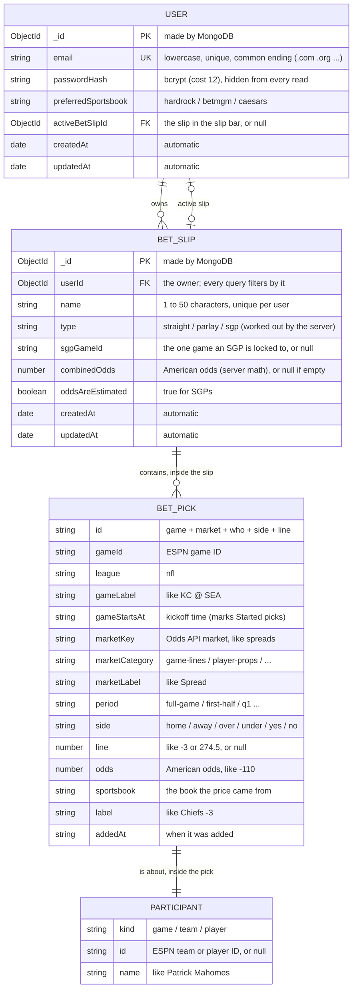
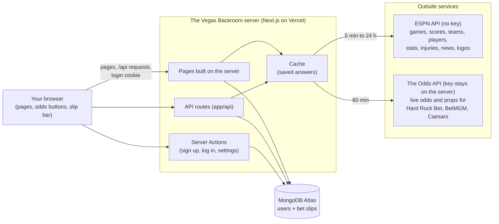

# The Vegas Backroom: data model (Week 6, archived)

> **ARCHIVED (Week 6).** This is the old Week 6 data model and data-sources picture. It is kept for history only and is **out of date** (it has no invite codes, login lockout, wagers, payouts, or copied slips). For the current versions, see [`docs/data-model.md`](../../data-model.md) and [`docs/system-diagram.md`](../../system-diagram.md).

How the app's data is organized: what's **stored in MongoDB** (users and bet
slips), how those records connect, and where the **sports data** comes from.

> GitHub draws these diagrams automatically. Picture versions are next to this
> file: `week6-capstone-database-diagram.png` / `.svg` (database) and
> `week6-capstone-data-sources-diagram.png` / `.svg` (where the data comes from).

---

## 1. What's stored in the database (MongoDB Atlas)

The database (`backroom-vegas`) has two collections: **users** and **betslips**.
Each bet slip holds its **picks** inside it (they aren't a separate collection),
and each pick holds a small **participant** (who the bet is about).

How to read the lines: a user **owns** any number of bet slips (0 or more), and
has **at most one active slip** (the one in the slip bar). A slip contains 0 to
25 picks, and each pick is about exactly one participant (the game, a team, or a player).

**Key rules the database enforces**

| Rule | How |
|---|---|
| One account per email | `email` is **unique** (and saved in lowercase) |
| Passwords are never stored | Only `passwordHash` (bcrypt). It's left out of every read unless the login check asks for it |
| No two slips with the same name for one user | A **unique index** on `userId + name` |
| A user's slips load fast, newest first | An **index** on `userId + updatedAt` |
| A slip can't grow huge | At most **25 picks** |
| Only real values | Sportsbook, league, market group, part of the game, and side must each be one of the allowed values. Odds must be real American odds |
| You only see your own slips | Every bet slip query includes `userId`, which always comes from the login cookie |

**Why picks are stored inside the slip:** a pick saves a copy of everything
needed to show it (team names, kickoff time, price, sportsbook). So a slip still
makes sense weeks later, after the game is over and the live odds are gone.

---

## 2. Where the data comes from

Only **users** and **bet slips** are saved in our database. Everything about
games, teams, players, odds, and news is fetched from outside services **by
the server**, checked, and cached (saved for a while).

**How the outside data connects to ours**

| Our data | Comes from | Linked by |
|---|---|---|
| A game (matchup) | ESPN | ESPN's game ID, used in addresses like `/matchup/401873022` and saved on each pick (`gameId`) |
| That game's odds | The Odds API | Matched to the ESPN game by **team names + kickoff time** (the two services use different IDs) |
| A team or player | ESPN | ESPN's team and player IDs (`/team/12`, `/player/3139477`), saved in a pick's `participant.id` |
| Player names in props | The Odds API (names only) | Matched to ESPN players by name, using both teams' rosters |
| Your sportsbook | Your account (`preferredSportsbook`) | Picks which of the three books' prices you see |

**Not stored on purpose:** games, odds, stats, and news are never saved in our
database, and no old (historical) betting lines are kept anywhere. Past games
show **stats only**.
