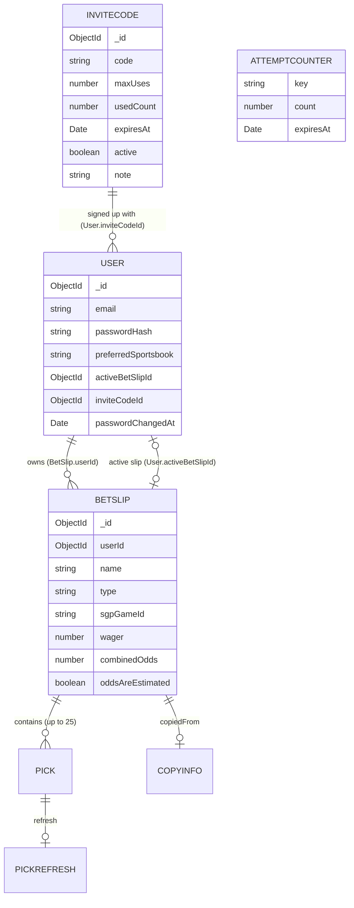

# Data model

The app uses **MongoDB** (through Mongoose). There are four collections. The files in `lib/db/models/` are the source of truth; this document matches them field for field. "Required" means the database refuses to save the record without it. Anything shown as `null` means **missing on purpose** (there is no value, and the page handles that).

**Which database:** the live site uses `backroom-vegas`. The Vercel Preview site and local development use `backroom-vegas-dev`. They are separate, so testing never touches live data.

## The link that ties data to a user

- **`BetSlip.userId`** (ObjectId, required, references `User`) ties every slip to its owner. Every slip query includes it, so a user can only see, change, copy, or delete their own slips. Asking for another user's slip returns `404`, the same as a slip that doesn't exist.
- `User.inviteCodeId` records which invite code a user signed up with.
- `User.activeBetSlipId` points at the slip shown in the slip bar.

## User (`users`) — `lib/db/models/User.ts`

| Field | Type | Required | Notes |
|---|---|---|---|
| `_id` | ObjectId | auto | |
| `email` | string | yes | unique, lowercased, trimmed, max 254, must look like an email |
| `passwordHash` | string | yes | bcrypt hash only. `select: false`, so queries don't return it unless asked. Never sent to the browser |
| `preferredSportsbook` | string | no | `hardrock` \| `betmgm` \| `caesars`; default `hardrock` |
| `activeBetSlipId` | ObjectId → BetSlip | no | `null` = no active slip |
| `inviteCodeId` | ObjectId → InviteCode | no | `null` = created before invite codes existed |
| `passwordChangedAt` | Date | no | `null` = never changed. Used to sign out other devices after a password change |
| `createdAt`, `updatedAt` | Date | auto | |

## BetSlip (`betslips`) — `lib/db/models/BetSlip.ts`

| Field | Type | Required | Notes |
|---|---|---|---|
| `_id` | ObjectId | auto | |
| `userId` | ObjectId → User | yes | **the owner** |
| `name` | string | yes | 1–50 characters, trimmed. Unique per user (`{userId, name}` index) |
| `type` | string | yes | `straight` \| `parlay` \| `sgp` |
| `sgpGameId` | string | no | ESPN game ID for a Build your own SGP slip; `null` otherwise |
| `picks` | Pick[] | no | default `[]`, at most 25 |
| `wager` | number | yes | pretend dollars, default 10, 0.01–10,000, at most 2 decimals |
| `combinedOdds` | number | no | American odds for the whole slip; `null` = empty slip (no odds yet) |
| `oddsAreEstimated` | boolean | yes | true for SGPs (real SGP prices are lower) |
| `copiedFrom` | CopyInfo | no | `null` = not a copy |
| `createdAt`, `updatedAt` | Date | auto | |

Indexes: `{userId, updatedAt: -1}` (list newest first) and `{userId, name}` unique.

### Pick (embedded in `picks`, not its own collection)

| Field | Type | Required | Notes |
|---|---|---|---|
| `id` | string | yes | max 300. Must be unique inside the slip: the API check (`lib/betting/validation.ts`) refuses duplicates, the database itself does not |
| `gameId` | string | yes | ESPN game ID, max 100 |
| `league` | string | yes | a slug from `config/leagues.ts` (`nfl`, `nba`, ...) |
| `gameLabel` | string | yes | like "KC @ SEA", max 100 |
| `gameStartsAt` | string | yes | ISO date-time |
| `marketKey` | string | yes | like `spreads`, `player_pass_yds`, max 100 |
| `marketCategory` | string | yes | `game-lines` \| `player-props` \| `team-props` \| `halves` \| `quarters` \| `dst` \| `specials` |
| `marketLabel` | string | yes | max 100 |
| `period` | string | yes | `full-game` \| `first-half` \| `second-half` \| `q1`–`q4` |
| `participant` | `{kind, id, name}` | yes | `kind`: `game` \| `team` \| `player`; `id` can be `null` (no ID); `name` required, max 100 |
| `side` | string | yes | `home` \| `away` \| `over` \| `under` \| `yes` \| `no` |
| `line` | number | no | like -2.5 or 219.5; `null` = no line (winner, anytime TD) |
| `odds` | number | yes | American odds (like -110 or +150) |
| `sportsbook` | string | yes | the book this price came from |
| `label` | string | yes | text shown on the pick, max 200 |
| `addedAt` | string | yes | ISO date-time |
| `refresh` | PickRefresh | no | set only on copied slips; absent otherwise |

### PickRefresh (on copied picks)

`status` (`updated` \| `unchanged` \| `no-odds` \| `not-checked`, required), `previousOdds` (number, required), `previousLine` (number or `null`), `previousSportsbook` (book id, required).

### CopyInfo (`copiedFrom`)

`fromName` (string, required, max 50), `sportsbook` (book id, required), `copiedAt` (string, required), `skipped` (array of `{label, gameLabel, reason}`, each required and length-limited; at most 25).

## InviteCode (`invitecodes`) — `lib/db/models/InviteCode.ts`

| Field | Type | Required | Notes |
|---|---|---|---|
| `_id` | ObjectId | auto | |
| `code` | string | yes | unique. Pattern: `BRV-` + 4 characters + `-` + 4 characters, capitals only, using the letters and digits `ABCDEFGHJKMNPQRSTUVWXYZ23456789` (no 0, O, 1, I, or L). Like `BRV-7K2M-Q9XD` |
| `maxUses` | number | yes | whole number, 1–1000 |
| `usedCount` | number | yes | default 0. Goes up only when an account is created |
| `expiresAt` | Date | no | `null` = never expires |
| `active` | boolean | yes | default true; false = turned off |
| `note` | string | no | like "graders", max 100 |
| `createdAt`, `updatedAt` | Date | auto | |

## AttemptCounter (`attemptcounters`) — `lib/db/models/AttemptCounter.ts`

Powers login protection, the invite-code guess limit, and the profile page's current-password checks. It is stored in the database (not memory) because Vercel can run the app on many servers.

| Field | Type | Required | Notes |
|---|---|---|---|
| `key` | string | yes | unique, max 200. A scrambled fingerprint (a keyed hash, `lib/security/keys.ts`), written `purpose:hash`, of what is being counted. Purposes in use: `login-email` (a login email), `profile-password` (a user ID on the Profile page), `login-address` (a login IP address), and `invite` (an invite-code guesser's IP address). The raw email or IP is not stored. It has no link to the User collection, so deleting an account does not delete these (they expire on their own) |
| `count` | number | yes | default 0 |
| `expiresAt` | Date | yes | MongoDB deletes the record automatically after this time (TTL index) |

Rules: 5 wrong passwords per email and 20 per IP address, then a 15-minute lockout. A good login resets the email's count.

## Not stored by us

Games, teams, players, odds, injuries, news, and live scores come from ESPN and The Odds API at request time and are cached in server memory for a short time. They are never saved in MongoDB. Picks save the odds as they were when added.
