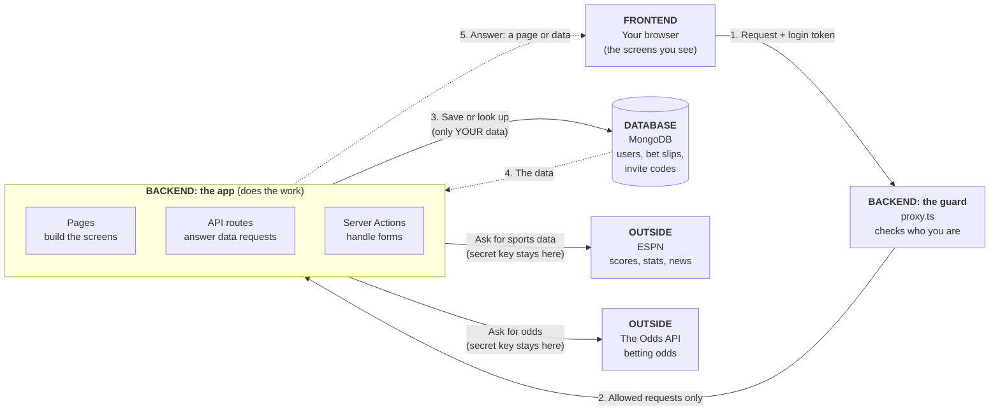
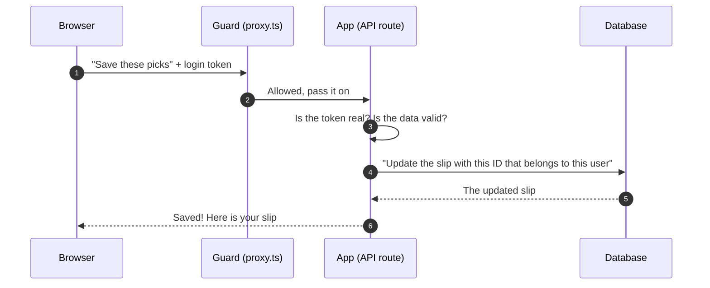

# System diagram

The Vegas Backroom is **one app** with three parts that talk to each other: what you see (the **frontend**), the code that does the work (the **backend**), and where information is saved (the **database**). The backend also gets sports data from two outside websites. It all lives in one Next.js project on Vercel, so one web address serves both the screens and the backend.

## The big picture

**How to read it:** solid arrows are asking for something. Dashed arrows are the answer coming back. Follow the numbers 1 to 5 to trace one trip from your browser to the database and back.

## What travels on each arrow

| Arrow | What travels | Plain-English example |
|---|---|---|
| Browser → Guard | A **request** plus your **login token** (a signed ticket kept in a cookie called `bv_session`) | "Show me my bet slips" and the ticket proving who I am |
| Guard → App | The same request, only if the ticket is real. If not, you are sent to the login page | A fake or missing ticket is turned away |
| App → Database | A **query**: a question for the database that always includes your user ID | "Find the slip with this ID **that belongs to this user**" |
| Database → App | The matching data | Your slip, never someone else's |
| App → ESPN / The Odds API | A request for sports data. The secret API key is added here, on the server, so your browser never sees it | "What are today's NFL odds?" |
| App → Browser | The **answer**: a finished page or data | The Bet Slips page with your slips on it |

## What each piece does

| Piece | Its job | Where it lives |
|---|---|---|
| **Browser (frontend)** | Shows the screens, and keeps your login ticket and invite ticket as cookies | `app/`, `components/` |
| **Guard** | Runs first on every request. Sends people without a login to the login page, only lets our own website use the API, and adds a safety rule for the page | `proxy.ts` |
| **Pages** | Build the screens on the server (Feed, Matchup, Team, Bet Slips, Profile) | `app/(main)/` |
| **API routes** | Answer data requests, like saving a bet slip | `app/api/` |
| **Forms (Server Actions)** | Handle log in, sign up, invite code, and profile changes | `app/actions/` |
| **Database** | Saves users, bet slips, invite codes, and wrong-password counts | MongoDB Atlas |
| **ESPN** | Free sports data: scores, stats, injuries, news, logos | outside website |
| **The Odds API** | Betting odds from the sportsbooks (limited free credits) | outside website |

**Three safety rules the picture shows**
- **The browser never talks to ESPN or The Odds API.** Only our server does, so the secret key stays secret and results are saved for a while to avoid using up the free limit.
- **Every request is checked.** The guard checks first, and the code next to the data checks again.
- **Every slip query includes your user ID,** so one user can never see another user's slips.

## One trip, step by step: saving a bet slip

You are logged in and you add a pick to your slip. This is what happens.

In words:
1. **Browser:** you tap a pick. The browser sends "save these picks" and automatically includes your login token.
2. **Guard:** `proxy.ts` makes sure the request comes from our own website, then passes it on.
3. **App:** the API route (`app/api/betslips/[id]/route.ts`) checks the token is real (no token or a fake one gets a `401` error) and checks the picks are valid (bad data gets a `400` error, and picks that can't both win get a `409` error).
4. **Database:** the app asks MongoDB to update the slip **only if it belongs to you**. If it belongs to someone else, it is simply "not found" (`404`).
5. **Answer:** the database returns the saved slip, the app sends it back, and your screen updates.

## Other trips, in one line each

- **Sign up:** enter an invite code → the code is checked and an invite ticket is saved in your browser → sign up form → the code is checked again and one use is counted as your account is created → you get a login ticket.
- **Log in:** email and password → the app checks for too many wrong tries (5 wrong passwords means a 15-minute wait) → the password is compared safely → you get a login ticket.
- **Live scores:** while a game is on, your browser asks our app for scores about every 30 seconds, and our app asks ESPN (and remembers the answer for 15 seconds).
