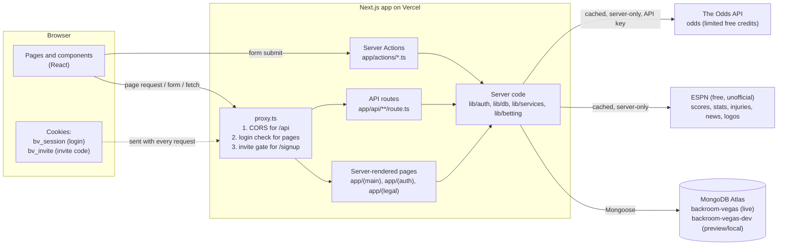

# System diagram

This shows the browser, the app (pages, API routes, Server Actions), the guard that runs first (`proxy.ts`), the database, and the three outside data services. Everything runs in **one** Next.js app on Vercel, so one URL serves both the screens and the API.

**Rules that the diagram shows**

- The browser **never** calls ESPN or The Odds API. Only server code does, so the API key stays on the server and results are cached to save the request limit.
- `proxy.ts` is a fast first guard. The real checks sit next to the data: `lib/auth/dal.ts` for pages and `withUser` in `lib/api/respond.ts` for API routes.
- Every database query for slips includes the logged-in user's ID, so one user can't reach another's data.

## One request traced step by step: "Add a pick, then save my slip"

Example: a logged-in user taps an odds button, then the slip is saved with `PATCH /api/betslips/<slipId>`.

1. **Browser**: `OddsButton` calls the slip provider (`components/betslip/BetSlipProvider.tsx`), which checks the conflict rules in the browser, then sends `PATCH /api/betslips/<slipId>` with `{ "picks": [...] }`. The browser automatically attaches the `bv_session` cookie.
2. **`proxy.ts`**: sees a path starting with `/api/`, applies the CORS rule (own site only, never `*`), and lets it through.
3. **Route** `app/api/betslips/[id]/route.ts` (`PATCH`): `withUser` reads the cookie, checks the signed token (`lib/auth/token.ts`), and loads the user from MongoDB. No cookie or a bad token gets `401`.
4. **Validation**: the body is size-limited (`413` if too big) and checked against `updateBetSlipRule` (`lib/betting/validation.ts`): allowed leagues, odds are real American odds, at most 25 picks, name at most 50 characters. A bad body gets `400` and nothing is saved.
5. **Conflict check again on the server**: `updateBetSlip` re-runs the pick rules (`checkPicks`: the conflict rules and the same-game rule for SGP slips). The browser already warned the user, but the server never trusts that. Picks that can't go together, or a slip name that is already taken, get `409` and nothing is saved.
6. **Database** `lib/db/betslips.ts`: the queries ask for the slip with **both** that `_id` **and** `userId = the logged-in user`, both when checking the picks and when saving. If the slip belongs to someone else it simply isn't found, so the answer is `404`.
7. **MongoDB** saves the slip. The server works out the slip type (straight, parlay, or SGP), the combined odds, and whether they are estimated itself (`getSlipPricing`), instead of trusting the browser's numbers.
8. **Response**: the route returns the updated slip as JSON (`200`). The provider updates the slip bar and panel, and the estimated payout recalculates instantly.

## Other flows in one line each

- **Sign up**: `/invite` (code checked, `bv_invite` cookie set) → `/signup` (`proxy.ts` requires the cookie) → `signup` Server Action re-checks the code, takes one spot with a single atomic database command (so two people can't take the last spot), then creates the user (the spot is handed back if that fails) → `bv_session` cookie set.
- **Log in**: `login` Server Action (or `POST /api/auth/login`) → lockout check (5 wrong passwords, 15 minutes, per email and per IP, stored in MongoDB) → bcrypt compare → `bv_session` cookie set.
- **Live scores**: the browser calls our own `GET /api/live` about every 30 seconds while a game is on and the tab is open; the server asks ESPN (cached 15 seconds).
- **Matchup stats**: `AutoRefresh` asks Next.js to re-run the server-rendered stats section about every 30 seconds while the game is live.
